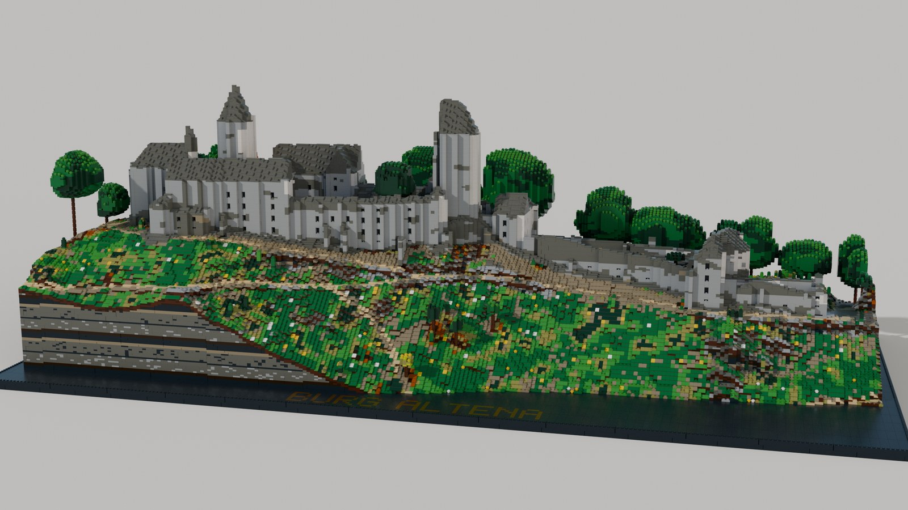
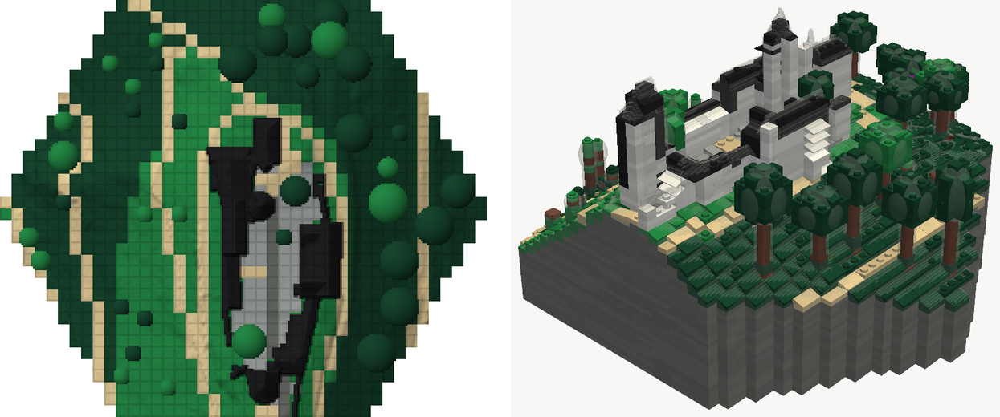
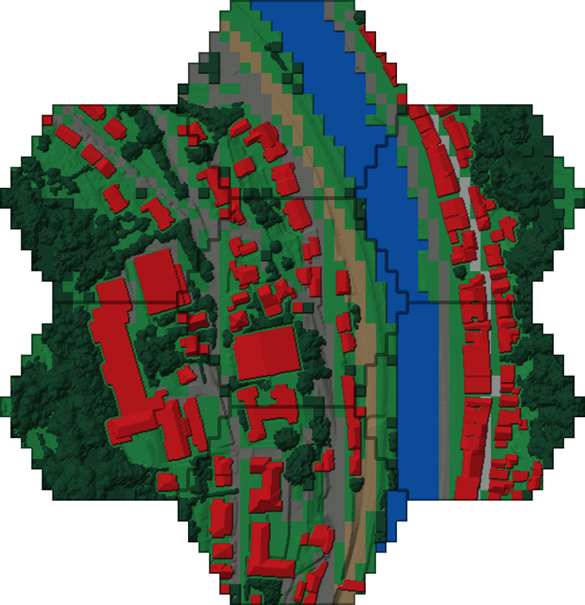
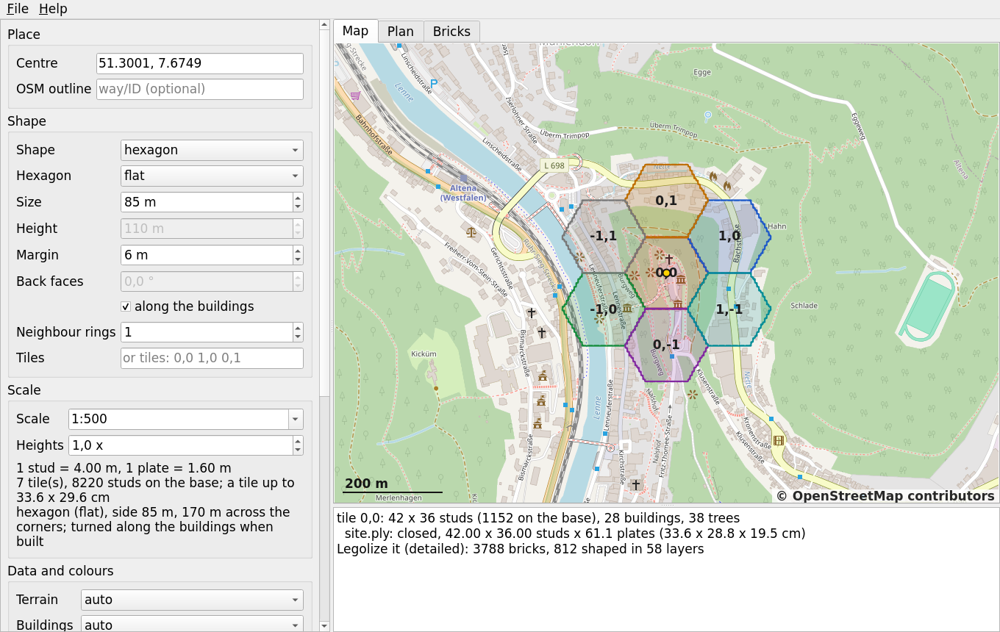

<p align="center"></p>

# TwinBrick it

**A place on earth as a brick model.** Give a GPS point, a shape - square, rectangle, hexagon, triangle, circle,
ellipse, any polygon or an OpenStreetMap outline -, its size and which way it faces, and a scale: TwinBrick it fetches
the place's digital twin (terrain, buildings with their roofs, trees, land use, roads, rails and water), turns it into
one closed, coloured mesh per tile, exactly whole studs wide, and has [Legolize it](https://github.com/CalzitPLA/Legolize-it)
lay the stud-and-tube bricks (the common 8 mm system): a parts list, pictures, a building manual, an order list.

Shapes that tile the plane come with **neighbour tiles that fit stud for stud** - build a hexagon today and its six
neighbours later, and they close up without a gap, at the same heights.

*The logo: Burg Altena in bricks, a render of the brick model the method of this program grew out of (Geobasis NRW
data, 2026-11).*

## What it does

1. **Where, which shape, which way.** A centre (decimal or degrees/minutes/seconds), a shape and its size on the
   ground, and the bearing the model's back edge faces - or *along the buildings*: the studs are turned so the
   buildings run along them (their outlines' dominant direction), so walls become straight rows of bricks. Instead of
   a size, a **corner** can be given (Shift+click on the map): it spans the shape to that point, size and turn at once.
   Polygons take their corners as GPS points, or an OpenStreetMap way/relation (a campus, a park, a castle ward) with
   a margin of ground around it.
2. **The scale.** 1:N, or metres per stud, or studs across. Heights in true proportion (a plate is 0.4 of a stud),
   or exaggerated.
3. **The data** (downloaded once, cached in `~/.cache/twinbrick-it`):
   - in North Rhine-Westphalia, the *Digitaler Zwilling NRW* of Geobasis NRW: the terrain **DGM1** (1 m), the
     buildings **LoD2** (CityGML, every roof surface), the height above ground **nDOM50** (0.5 m) for the trees;
   - everywhere else: elevation from the **Terrain Tiles** (AWS open data; SRTM, EU-DEM, 3DEP ...) and buildings
     from **OpenStreetMap** footprints with their heights (height, levels or the building's type) and roof shapes;
   - everywhere: land use, roads, paths, rails, rivers, lakes, woods and single trees from **OpenStreetMap**.
4. **The tile.** The studs whose centre lies in the shape; the ground per stud from the land use (green, fields,
   forest floor, sand, rock, paving, rails, water), roads, paths, rails and streams drawn straight onto the studs and at
   least a stud wide so they stay connected lines; water a plate below its banks; bridges at the height of their ends;
   buildings from their roofs; trees as **lollipops** (a 1x1 trunk under a round crown, where the crowns' tops are), as
   the true **canopy**, or **flat**. Slivers thinner than about half a stud go; a small but tall structure (a
   chimney) becomes one stud column; a low one goes.
5. **The mesh.** One closed surface with a colour per face - no hidden faces for the bricks' colours to pick up -,
   closed edge to edge (no T-junctions: it prints as it is), whole studs wide and standing on whole plates; plus a plan
   picture and `site.json` with the georeference (anchor, bearing, scale, datum, the tiles' stud origins, sources and
   attributions).
6. **The bricks.** Legolize it in one of its looks: *bricky* (plain bricks and plates), *detailed* (slopes on the
   terrain, tiles on top, trunks as round 1x1 bricks) or *artsy*; the base hollow, the colours from the mesh.

<p align="center"></p>

*Burg Altena as one hexagon (85 m sides, 1:500, Sauerland colours: slate roofs, white walls), made with
`twinbrick-it cli 51.3001,7.6749 --shape hexagon --size 85 --scale 500 --rotation auto --theme sauerland --bricks detailed`:
42 x 36 studs (34 x 29 cm), 3,788 parts. Left the plan, right Legolize it's picture (the input translucent over the
bricks).*

<p align="center"></p>

*Seven hexagons (`--ring 1`) over Altena and the Lenne valley at 1:1000 - each tile a model of its own, the seams
stud for stud. Outside NRW the same works from OpenStreetMap and the worldwide elevation tiles (tested on Heidelberg's
old town: 482 buildings with gabled roofs from their outlines).*

## Install

TwinBrick it needs **Python 3.10 or newer** with numpy, scipy, trimesh, Pillow and PyQt5, and **Legolize it** for the
bricks (with libigl, manifold3d and vtk). The installer takes care of both:

```bash
git clone https://github.com/CalzitPLA/TwinBrick-it.git
cd TwinBrick-it
./install.sh            # finds Legolize it (installed, next to this folder, or it fetches it), the command
                        # twinbrick-it, the desktop entry "TwinBrick it" with its icon; when Legolize it is installed,
                        # TwinBrick it shares its Python environment (nothing more to download)
twinbrick-it check      # packages, the engine, the desktop entry, one site built offline and laid in bricks
```

On Debian the system's packages help (`sudo apt install python3-numpy python3-scipy python3-pyqt5 python3-pil git`);
see Legolize it's README for macOS and Windows (WSL) - the same steps apply.

**Uninstall:** `twinbrick-it uninstall` (the same as `./install.sh --uninstall`) removes the command, the desktop
entry, the icons and what the installer made in `~/.local/share/twinbrick-it` (its own environment, its copy of
Legolize it) - an environment it shares with Legolize it stays. `--purge` also removes the data cache
(`~/.cache/twinbrick-it`) and the server list (`~/.config/twinbrick-it`). Your results in `~/legolize_results` always
stay.

## Use

**The window:** `twinbrick-it [LAT,LON]`, or *TwinBrick it* in the applications menu.

<p align="center"></p>

- the map (OpenStreetMap): **click** sets the centre, **Shift+click** spans the shape to that corner, drag pans, the
  wheel zooms; the tiles are drawn as they will be built - their outline and their studs;
- left: the place (or an OSM outline), the shape, the bearing or *along the buildings*, neighbour rings or a list of
  tiles, the scale and height exaggeration (with what a stud and a plate are on the ground and how large the tiles
  become), the data, the tree style, the colours (*classic*, *minimal*, *architecture*, *sauerland*), Legolize it's
  look, the results folder, and **Run on** (this computer or a server);
- **Build** (F5) fetches, builds and lays the bricks in the background (the log below the map); then the *Plan* and
  *Bricks* tabs show the results, **Open in Legolize it** (Ctrl+L) opens the site in its window - to change sizes and
  looks live, export the STL stack, the FreeCAD document, the manual and the order list there.

**The command line:**

```bash
twinbrick-it cli 51.3001,7.6749 --shape hexagon --size 85 --scale 500 --rotation auto --bricks detailed
twinbrick-it cli "51°24'06\"N 8°03'41\"E" --shape square --size 200 --scale 1000 --rotation 15
twinbrick-it cli 51.40,8.06 --shape hexagon --size 100 --scale 1000 --ring 1          # the tile and its 6 neighbours
twinbrick-it cli 51.40,8.06 --shape hexagon --size 100 --scale 1000 --tiles "1,-1"    # one neighbour, later
twinbrick-it cli 51.40,8.06 --shape hexagon --corner 51.401,8.062 --scale 750        # spanned to a corner
twinbrick-it cli --osm way/146943431 --margin 6 --scale 750 --theme minimal          # an OSM outline
twinbrick-it cli --at=-33.8568,151.2153 --shape circle --size 400 --scale 2500       # south / west: --at=
twinbrick-it cli 51.40,8.06 --shape triangle --size 150 --scale 750 --plan            # only the studs, no download
#   <out>/site.ply           the mesh (mm; whole studs; closed) - <out>/tile_Q_R.ply for several tiles
#   <out>/site_plan.png      the plan; overview_plan.png for several tiles
#   <out>/site_raster.npz    heights, classes and studs as arrays
#   <out>/site.json          georeference, scale, datum, tiles, sources, attributions
#   <out>/bricks/            Legolize it's result.json, render.png (manual/ with --manual)
```

Options worth knowing: `--vertical 2` (heights x2), `--datum M` (the model's bottom in metres above sea level: give the
same to tiles built one at a time, so their ground meets), `--tree-style lollipop|canopy|flat`, `--theme`, `--colours
roof=dark_red,road=black` (any class: ground field forest sand rock paved rail water path road bridge roof wall tree
tree2 trunk base), `--osm-colours` (roof:colour and building:colour from OSM), `--min-line 0.35` (roads narrower than
this share of a stud are left out), `--engine-args "--cheapest --order de"` (anything for Legolize it), `--offline`.

## The results page

```bash
twinbrick-it report --open                    # every site in ~/legolize_results -> twinbrick_results.html
twinbrick-it report ~/legolize_results/burg_altena_hexagon --out altena.html
```

One HTML file that needs nothing else (pictures embedded, three.js inlined, it works offline): per site an
interactive 3D view of the bricks - slopes as wedges, round 1x1 bricks, studs where nothing covers them, a slider and
*build up* to watch it grow layer by layer -, the numbers (parts by kind, size, whether it holds together), the
colours with their counts, the plan, Legolize it's picture and the command that makes the site again; tiled sites show
all tiles in place. In the window: *File > Results page* (Ctrl+R). three.js r128 is MIT-licensed
(`twinbrick/vendor/three_LICENSE`).

## Servers (ssh)

Large sites can be built on another machine: the whole build - downloads, mesh and bricks - runs there, the results
come back.

```bash
twinbrick-it server list                     # the hosts of ~/.ssh/config (aliases only) and the servers set up
twinbrick-it server add HOST ~/twinbrick_it --python ~/venvs/bricks/bin/python
twinbrick-it server sync HOST                # copy this TwinBrick it and its brick engine to that path
twinbrick-it server check HOST               # Python and packages there
twinbrick-it cli 51.30,7.67 --shape hexagon --size 300 --scale 1000 --ring 2 --server HOST
```

In the window: *Run on* and *Servers ...*. Nothing about a server is read, written or published beyond its ssh alias:
ssh itself resolves host names, addresses, users and keys (BatchMode: a key or an agent); the servers set up are kept
in `~/.config/twinbrick-it/servers.json` (mode 600) - never in this repository or in results; every run works in a
fresh `mktemp -d` folder on the server that is removed afterwards, and the files that come back are rewritten to name
the local folder, not the server's. The tests use a stand-in for ssh, and one of them checks that the repository holds
no IP address, home folder or e-mail address.

## How it works

- **Coordinates:** WGS84/ETRS89 to UTM with Krüger's series to n⁴ (sub-millimetre, both ways; zone 32 throughout
  NRW, as its data are), the grid convergence (a bearing is true north), the point scale factor (1:N is on the
  ground). Local metres *u, v*: the model's right and back.
- **The stud grid** is one per frame: tile (q, r) of a tiling has its own centre, but every tile uses the same grid, and
  a stud belongs to the tile its centre lies in - with the same tiny offset for every tile, so a centre on a shared
  edge goes to exactly one of them. Squares and rectangles are rounded to whole studs and their edges lie on stud
  boundaries.
- **The raster:** about 0.7 m cells (2 to 12 per stud). Terrain bilinear from the DGM; LoD2 roofs as the planes of
  their surfaces, clamped to each surface's own height range (a steep roof's plane would shoot past its edge);
  OSM buildings from the lowest ground under them, a hipped or gabled roof from the distance to the outline; land use
  painted in order, decided per stud by cover; lines onto the studs.
- **The mesh:** columns from the base to each cell's top; sides only where a neighbour is lower, split at the cell's
  ground into ground colour (or the base colour on the outside) and the object's side (wall, tree; roof colour for a
  step between roofs); every side face split at every corner height its neighbours have, as a strip of triangles,
  vectorised. Trees as lollipops are closed bodies beside it: a trunk exactly one stud square, from a plate below the
  stud's mean ground, and an ellipsoid crown with a flat underside, kept inside the tile.
- **The bricks:** `python -m lego_engine site.ply --scale 1 --unit plate --shell 3 --thin-walls off --colours source`
  plus the look's options (`twinbrick/engine.py`).

## Data and licences

| | licence |
|---|---|
| Geobasis NRW (Digitaler Zwilling NRW): DGM1, nDOM50, LoD2 - opengeodata.nrw.de | Datenlizenz Deutschland - Zero - 2.0 |
| OpenStreetMap data (Overpass API) and map tiles (tile.openstreetmap.org, cached) | (c) OpenStreetMap contributors, ODbL 1.0 |
| Terrain Tiles (AWS open data registry) | SRTM, GMTED, ETOPO1, EU-DEM (Copernicus), 3DEP and others - [attribution](https://github.com/tilezen/joerd/blob/master/docs/attribution.md) |

Every `site.json` lists the attributions of the data it was made from. Please keep them with what you share.

## Tests

```bash
python3 -m pytest tests -q        # 42 tests, ~5 s, offline: synthetic OSM, flat ground, a stand-in for ssh, the window
```

## Limits

- 2.5D: every column is filled from the base up - no arches, passages or overhangs (a bridge stands on the ground
  below it; trees as lollipops are the one exception).
- Outside NRW, buildings are only as good as OpenStreetMap's: without height or levels, a type's typical height is
  used (houses under 250 m² get a gabled roof).
- The sea is found by a rule, not from coastline polygons: when OpenStreetMap has a coastline in the area, studs at
  sea level (0.5 m or lower) that no land use covers become sea, its surface at sea level (the elevation tiles carry
  the sea floor). Land below sea level without mapped land use next to a coast would be taken for sea.
- The Terrain Tiles are about 30 m outside the US: hills come out smooth.
- The public Overpass servers (OpenStreetMap) are often busy: a site's query can take minutes of retries across the
  mirrors (the one that answered last is tried first). Each answer is cached, so building the site again, at another
  scale or with other colours, needs no download.
- A tile's trees and crowns stay inside it; the neighbour's trees are its own.

## Licence

GNU General Public License v3 (see `LICENSE`). TwinBrick it is not affiliated with any maker of bricks; the brick
engine Legolize it keeps its own notice of the trademarks it names.
